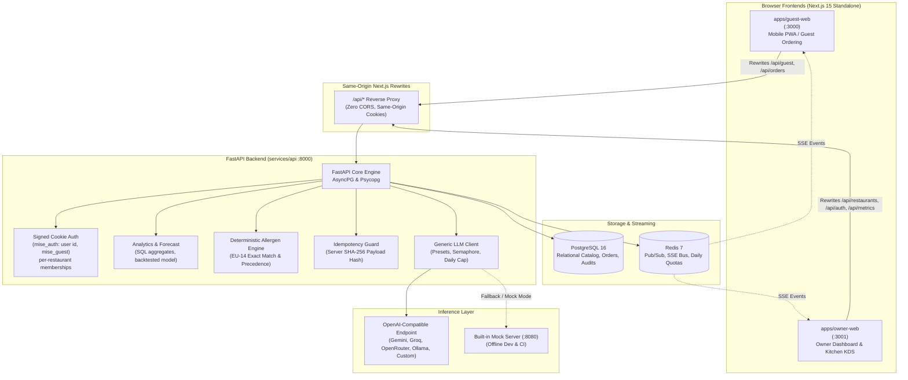

# Mise — Restaurant Revenue Copilot & Kitchen Operations Platform

Mise is an ordering, kitchen and revenue analytics platform for independent restaurants. Guests scan table QR codes to open a web menu with deterministic allergen filtering, English and Italian localization, and ordering. Dishes can have sizes (half / full, ½ kg / 1 kg, regular / large). Staff open a table before its guests can order and approve the first order of each visit with one tap; orders then flow in real time to a Server-Sent Events (SSE) kitchen display system (KDS), and each table's orders gather on one bill that staff settle and print as a sample bill with illustrative Pakistani sales tax. Owners and staff sign in with their own accounts and see only the restaurants they belong to. Owners get a daily revenue brief computed from order history (KPIs, menu engineering, a backtested 7-day demand forecast and ranked actions), a deterministic what-if calculator, and visual menu ingestion. The language model only writes plain-language summaries of numbers that were already computed.

---

## Features

- **Guest Mobile Web Ordering (`guest-web`)**
  - QR-driven table session initialization.
  - English and Italian (only these two languages are supported).
  - Deterministic EU-14 allergen cross-referencing with explicit acknowledgment guards.
  - Size picker for dishes with sizes; prices in PKR (`Rs 2,100`) with the note "Prices exclude sales tax, which is added to your bill."
  - **Opening a table and the first order**: a phone that scans a table staff have not opened sees "Your table will be ready in a moment. A waiter is on the way." and no Confirm Order button; the menu checks again every 5 s and switches to ordering without a reload once staff tap Open table. The first order of each visit shows "Sent! Your waiter is confirming your order." and reaches the kitchen only when staff approve it ("Confirmed — it's being cooked"); a waiting order is on no bill. If staff answer Not now, the phone goes back to the menu with "Your waiter will come to your table to help." and the dishes back in the cart. Later orders of the visit go straight to the kitchen. The owner can turn on "Ask guests for a 4-digit table number before their first order" (Tables page, next to the payment settings); staff read the number out when they open the table, and a phone types it once per visit ("That number didn't match. Please ask your waiter.", and a one-minute wait after 5 wrong tries). After 20 wrong tries at one visit from all phones, no new phone can join it for 10 minutes ("Please ask your waiter to help you order."); staff closing and reopening the table gives a new number. One address may start 60 guest sessions per 10 minutes. An open table with no order, call or payment for 90 minutes closes by itself, never while its bill is unpaid. Limits: 3 orders per phone per 5 minutes and 30 items per order; a first order above four times the venue's average dish price says "That's a big order! Your waiter will confirm it with you." Once the bill is settled, the phone's menu says "Thanks for visiting!".
  - **Table self-service**: at an open table, guests order more rounds onto the table's one open bill from any phone, call a waiter and choose how to pay.
  - **Call waiter** (menu and order pages, tables only): "Need help", "Water, please" or the venue's own extra reason ("More naan / roti" at Angeethi House, "More napkins / cutlery" at Kehwa & Crumb). The button then reads "Waiter called · m:ss" until staff tap Done. One open call per table; a new call is refused for 60 s after the previous one.
  - **Pay from the table** ("Pay bill" on the order page): lines, subtotal and the total for each of the five payment methods with its tax rate. Cash → "A waiter is coming to collect Rs X."; Card → "A waiter is bringing the card machine."; JazzCash / Easypaisa, Raast QR and Bank transfer show the venue's payment details with copy buttons, and the guest pays in their own app, enters the transaction id and taps "I've paid" → "Payment sent — waiting for staff to confirm." Choosing a method records a claim and counts as asking for the bill; the latest claim wins until staff confirm. A retried "I've paid" after a dropped connection records the same claim, not a second one. Demo venues show sample details (`0000 SAMPLE`) under "Sample payment details — demo only. Do not send money." Orders staff voided show "Removed by staff: {item} ×{qty}" and leave the total. **Guests never settle a bill**: staff confirm, and the page then shows "Paid · Bill no. 0042 · thank you".
  - **Counter pickup** (Kehwa & Crumb "Counter", Angeethi House "Takeaway"): the counter QR's menu says "Counter order — pay first, then collect". After ordering the guest sees a large pickup number (`K-001`, `P-001`, per venue per local day, never wrapping) and the same Pay sheet. The order reaches the kitchen only once staff confirm payment ("Paid — preparing your order"), then "Ready — collect K-001 at the counter" and "Collected · enjoy!". No Call waiter at the counter; unpaid, unclaimed counter orders are cancelled after 30 minutes.
  - **Pay-it-forward chai**: a menu item a guest can buy for someone who needs it; once the bill is settled the guest sees "You bought N chai for someone who needs it. Shukriya."
  - Cart persistence with server-verified idempotency tokens.
  - Live order status tracking powered by Server-Sent Events (SSE).
  - AI menu chat assistant (sees the menu only, never the guest's allergen or dietary profile).

- **Kitchen Display System (`owner-web`)**
  - Low-latency, high-contrast KDS optimized for busy kitchen lines.
  - Real-time SSE order streaming with automatic reconnection and polling fallbacks.
  - High-visibility allergy alert banners extracted from immutable order item snapshots.
  - Each ticket line shows the chosen size ("Chicken Karahi — 1 kg").
  - Counter tickets read "PICKUP K-001" in large type; pay-it-forward handouts read "PAY-IT-FORWARD · Chai". Unpaid counter orders and first orders waiting for staff approval never appear.
  - Color-coded ticket aging (green under 10 minutes, amber from 10 minutes, red from 20 minutes).
  - Idempotent ticket bump workflow with a 60-second undo recall safety window.

- **Accounts and venues**
  - Per-user email and password sign-in (scrypt hashes); each user has an `owner` or `staff` membership per restaurant. Any `/api/restaurants/{slug}/...` route answers 404 "Restaurant not found" to a non-member, exactly as for an unknown slug; staff get 403 on owner-only routes.
  - Owners with several venues switch between them in the sidebar; staff-only accounts open the kitchen display.
  - No public sign-up: clients are onboarded with `scripts/admin.py` (see Quick Start).
  - Two demo venues: **Angeethi House** (Lahore, Punjab; BBQ, karahi, handi, tandoor) and **Kehwa & Crumb** (Islamabad; coffee, chai, bakery). Prices and costs are illustrative.

- **Floor view (`/floor`, staff and owner, first under "Service")**
  - One tile per table (counters excluded) with its state in text, icon and colour, time in state (ticking from the server clock, so a wrong device clock does not skew it), running total and open call reason. Red first, then amber, then table order; a list on phones. Tiles reload on kitchen-stream events and every 30 s; the sidebar badge "Floor (n)" counts red and amber tiles.

    | State | When | Amber / red after |
    |---|---|---|
    | Free | nobody scanned since the table was cleared and no open bill | — |
    | Guests waiting to order | a guest scanned but staff have not opened the table | 1 / 3 min |
    | Approve order | the visit's first order waits for staff, with its item count and total ("1 item · Rs 300") | 1 / 2 min |
    | Seated, no order | a guest scanned since the last clear, settle or cancelled bill, no order yet | 3 / 5 min |
    | Ordered | open bill with an order the kitchen has not bumped | 12 / 18 min from the oldest such order |
    | Served | open bill, every active order bumped | timer only |
    | Paying | open bill with a payment claim or bill request | 3 / 5 min from the claim or request |
    | Needs clearing | bill settled or cancelled (every order voided) since the last clear, no newer open bill | 2 / 5 min from the settle or cancel |
    | Waiter called | an open call; overrides every other state | red at once |

    Precedence: Approve order > Waiter called > Guests waiting to order > Paying > Ordered > Served > Seated > Needs clearing > Free, so dessert ordered after paying shows Ordered. The thresholds and states come from [docs/research/2026-10-25-floor-view-notes.md](docs/research/2026-10-25-floor-view-notes.md).
  - Actions: Open table (on a free table or one with guests waiting; an open table shows seated from the moment it is opened, even before anyone scans; when the venue asks for a table number, the tile shows it once in large type until Done), Approve / Not now (the waiting orders the tile shows; Not now leaves the table open), Close table (refused until the bill is settled; cancels any waiting orders; phones that scanned during the visit must scan again and no longer show as guests waiting), Done (resolve the call), Mark cleared (refused while a bill is open, and while new guests are already seated unless staff choose "Clear anyway"), Open bill. A pay-it-forward tile shows "Pay-it-forward chai: N waiting" with **Give one**, which sends a free "PAY-IT-FORWARD · Chai" ticket to the kitchen and is disabled when none is waiting.

- **Bills and sample bill (`owner-web`, staff and owner)**
  - Bills page: Tables and Counter tabs, live over SSE, requested first, with the guest's claim on each row ("Guest paying: Raast QR · ref …", "Guest paying: cash", "Card machine requested"); a Cancelled tab.
  - Confirm sheet: each order with its device label ("Phone 1", "Phone 2", numbered by each phone's first order on the bill) and a red "Joined late" flag when a phone's first order lands on a bill open for more than 20 minutes, the total per payment method (Cash, Card, JazzCash / Easypaisa, Raast QR, Bank transfer), the method pre-selected from the claim, the amount and reference in large type with "Check your JazzCash / bank app for ref … and Rs … before confirming.", warnings for an amount still due or overpaid ("Guest sent Rs A · bill is now Rs B · Rs … still due") and for a reference already used on another bill of the venue in the last 7 days (confirm only after "I've checked — confirm anyway"). "Confirm received" sends the total and method shown; the server recomputes them under the bill lock and refuses on any difference, and the sheet then reloads with "The bill changed — check the new total". When two staff confirm the same bill, one wins and the other sees that it is already settled. Staff can void an order with a reason; voiding the last order of a bill the guest says they paid asks before cancelling the bill. Settling snapshots subtotal, tax rate, tax and total on the bill and records who settled it.
  - **The demo cannot verify a transaction with a bank.** "Confirm received" is a staff check: staff look for the reference and amount in the venue's own banking or wallet app before confirming. Nothing settles without a staff action.
  - Counter tab: Awaiting payment (Confirm received / Cancel), Preparing, Ready (Collected, with a 60 s Undo). Expired unpaid orders move to Cancelled with "Take late payment".
  - Printable 80 mm sample bill with "Sales tax (illustrative)" and the footer "Sample bill — not a tax invoice." (Pakistani bills add "Not connected to FBR or any provincial revenue authority.")
  - Sales tax rates live in `data/tax_rates.json`, one row per jurisdiction, payment class and start date, each with its legal source: Punjab 16% (cash, bank transfer) / 8% (card, wallet, QR) from 1 July 2026 under the Punjab Sales Tax on Services Act 2012 as amended by the Punjab Finance Act 2026 (16% / 5% before); Islamabad 15% / 5% under the ICT (Tax on Services) Ordinance 2001. Verification notes: [docs/research/2026-10-24-tax-rate-verification.md](docs/research/2026-10-24-tax-rate-verification.md).

- **Owner Revenue Copilot (`owner-web`)**
  - Revenue brief (`/brief`) over the last 28 days: revenue, average order value and contribution margin from order snapshots; menu-engineering quadrant (star, plowhorse, puzzle, dog by median units and median unit margin) with one row per dish and size; top item pairings by lift; peak hours; payments and tax (cash vs digital share of bills and revenue, tax per rate, and the tax saved by digital payments).
  - Service report (owner only, on the Brief page) for a chosen local day, over the tables closed that day: tables served, average time per table, busiest hour, the average wait for each step (first order, waiter confirming the first order, kitchen, bill), the slowest hour (among hours with at least 2 tables) and its slowest step, and how many tables went red on the Floor at each step. Tables closed without a bill and simulated tables are counted apart. Code computes every number; the one-line summary is model-written or a template, checked against the numbers.
  - 7-day forecast per item and daypart (lunch/dinner): seasonal-naive and 4-week-mean baselines plus a gradient-boosting model, compared in a 14-day rolling-origin backtest; the lowest-WAPE method is used and its WAPE is shown next to the naive baseline. Under 14 days of history it uses the baseline and is flagged low confidence. No weather, holidays or reservations are modeled.
  - 3 to 5 ranked actions (promote puzzles, reprice plowhorses, review dogs, prep targets) with evidence numbers and estimated weekly impact from documented formulas.
  - What-if calculator (`/ai`): price change, promotion or demand surge on recent sales with stated elasticity assumptions; returns weekly revenue and margin deltas. Cannibalization, capacity and staffing are not modeled.
  - Simulated demo data (`make simulate` or the **Generate demo data** button in DEMO_MODE, limited to 3 runs per hour per client IP), from each venue's own profile (service hours, party sizes, dish and size popularity, an assumed payment mix), with one settled bill per simulated party. Always stored as `source='simulated'` and labeled in the UI. Regenerating replaces the previous simulated orders, bills and stored forecasts; live orders and bills are never touched.
  - Visual Menu Ingestion (VLM) for digitizing paper menus from photo URLs into structured catalog items.
  - Table management and QR code generator; the counter QR is listed and printable like the table QRs.
  - Venue settings on the Tables & QR page: payment details guests pay into (Raast ID, JazzCash, Easypaisa, IBAN, account title), pickup prefix and the extra call reason. Validation: IBAN `PK` + 22 characters with the mod-97 checksum; JazzCash and Easypaisa a mobile number `03` + 9 digits (`+92`, `0092` and `92` forms are normalised to `03…`); Raast ID a mobile number or IBAN; an account title of 2–80 characters is required with any of them. Sample values are accepted only on demo venues and always shown under the demo banner.
  - The brief shows pay-it-forward chai bought and given over the last 7 days; handouts are never revenue.
  - Methods, assumptions and limits: [docs/analytics.md](docs/analytics.md).

---

## Tax and currency

Each venue has a tax jurisdiction and bills and reports in that jurisdiction's currency (no exchange rates, no combined totals). The rules are data: dated rates with a legal source per row in `data/tax_rates.json`, and per-jurisdiction pricing, rounding, payment methods and service-charge rule in `data/tax_jurisdictions.json`. The seed and admin scripts refuse a venue whose currency is not its jurisdiction's.

| Code | Jurisdiction | Currency | What it does |
|---|---|---|---|
| `PB` | Punjab, Pakistan | PKR | Sales tax added on top of menu prices: 16% cash or bank transfer, 8% card, wallet or QR; whole rupees; all five payment methods |
| `ICT` | Islamabad, Pakistan | PKR | Sales tax added on top: 15% cash or bank transfer, 5% card, wallet or QR; whole rupees; all five payment methods |
| `GB` | United Kingdom | GBP | Menu prices include VAT 20% (the guest pays the menu price; VAT is worked out once on the bill); pence; cash and card only; the owner may set an optional table service charge (0–20%), shown on the menu before ordering, chosen by the guest on the pay sheet, never taxed and never counted as revenue |
| `AE-DU` | Dubai, UAE | AED | Menu prices include VAT 5%; fils; cash and card only; no service charge |

Any other payment method is refused at venues that do not accept it. Where prices include VAT, the guest menu says "Prices include VAT.", the bill shows "VAT 20% included", and the brief's sales figures exclude VAT using each bill's recorded VAT; the service charge appears apart as "Service charge collected (for staff)". Bills stay sample bills, never tax invoices. Details: [docs/architecture.md](docs/architecture.md) and [docs/analytics.md](docs/analytics.md).

---

## Architecture



---

## Screenshots

Screenshots are produced by `make e2e` in `test-results/screens/`: guest menu, size picker and order sheet on a phone; kitchen display, sample bill and owner brief on desktop; every guest screen at 360 px on slow 3G (`slow3g-*.png`).

---

## Quick Start

### Prerequisites

- **Docker & Docker Compose** (v2+)
- **Node.js 22 LTS** & **pnpm 9** (`corepack enable`)
- **Python 3.11** & **uv** (`pip install uv`)

### 1. Clone & Configure Environment

```bash
cp .env.example .env
```

### 2. Boot Full Stack

```bash
# Start all services with health checks
docker compose up -d --build --wait

# Run database migrations
make migrate

# Seed both demo venues (menus with sizes, tables); with DEMO_MODE=true also the demo users
make seed

# Optional: 56 days of simulated demo orders and settled bills for every demo venue
make simulate
```

With `DEMO_MODE=true` the owner login page has **Enter as demo owner** (both venues) and **Open
kitchen display (demo staff)** (Angeethi House); `POST /api/auth/demo-login {"role": "staff",
"venue": "kehwa-and-crumb"}` signs in the café's demo staff.

### Onboarding a client restaurant

```bash
docker compose exec api python scripts/admin.py create-restaurant \
    --slug cafe-x --name "Cafe X" --city Lahore --jurisdiction PB --currency PKR --timezone Asia/Karachi
docker compose exec api python scripts/admin.py add-user \
    --email boss@cafex.pk --name Boss --restaurant cafe-x --role owner
```

`create-restaurant` refuses a jurisdiction with no tax rates in `data/tax_rates.json`. `add-user`
prompts for the password (never read from the command line or printed); for an existing user it
only adds the membership.

### 3. Access Services

- **Guest Web & Live Demo**: [http://localhost:3000](http://localhost:3000)
- **Owner Dashboard & Login**: [http://localhost:3001](http://localhost:3001)
- **Kitchen Display System**: [http://localhost:3001/kitchen](http://localhost:3001/kitchen)
- **API Health & Documentation**: [http://localhost:8000/health](http://localhost:8000/health)

---

## Environment Variables

| Variable | Default | Purpose |
|----------|---------|---------|
| `DEMO_MODE` | `false` | Enables demo users and demo login, `/api/demo/info`, demo data generation and the demo banner. |
| `APP_ENV` | `dev` | Application environment (`dev`, `staging`, `production`). In non-dev, boot fails if default secrets are unchanged. |
| `API_SECRET_KEY` | `change_me_in_production` | HMAC secret for signing auth session cookies. |
| `POSTGRES_HOST` / `POSTGRES_DB` | `postgres` / `mise` | PostgreSQL connection coordinates. |
| `REDIS_URL` | `redis://redis:6379/0` | Redis connection URL for pub/sub and rate limiting. |
| `LLM_PROVIDER` | `mock` | `mock` (internal fast mock server) or `openai_compatible`. `mock` is a hard switch: both base URLs are replaced by `MOCK_BASE_URL`, so a real URL left in `.env` is never called. |
| `MOCK_BASE_URL` | `http://inference:8080/v1` | Mock server URL used when `LLM_PROVIDER=mock`. |
| `TRUSTED_PROXY_CIDRS` | `["172.16.0.0/12"]` | Proxies whose `X-Forwarded-For` is used for per-IP limits (see docs/architecture.md). |
| `LLM_PRESET` | `custom` | Provider preset (`gemini`, `groq`, `openrouter`, `ollama`, `custom`). |
| `LLM_PROVIDER_LABEL` | `OpenAI-compatible endpoint` | Friendly display name shown in metrics and UI. |
| `LLM_FREE_ONLY` | `true` | Policy guard: enforces free-tier restrictions and model naming. |
| `LLM_DAILY_REQUEST_CAP` | `200` | Max daily inference calls for non-local providers. |
| `LLM_BASE_URL` | `http://inference:8080/v1` | Base URL for LLM chat completion endpoints. |
| `LLM_MODEL` | `mock-llm` | Configured text model identifier. |
| `VLM_BASE_URL` | `http://inference:8080/v1` | Base URL for vision/multimodal endpoints. |
| `VLM_MODEL` | `mock-vlm` | Configured vision model identifier. |
| `LLM_GLOBAL_RPM` | `15` | Global requests-per-minute ceiling enforced in Redis. |

---

## Free LLM Options

Mise follows a strict **Free-Only Policy** (`LLM_FREE_ONLY=true`). The project never requires a paid subscription or default credit card. Five provider presets are supported out of the box:

> [!WARNING]
> **Privacy Note on Free LLM Tiers:**
> Free API tiers provided by cloud AI vendors may use submitted prompts to train or improve their models. To protect diner privacy, Mise operates under an **air-gapped privacy design**:
> - Models receive menu data (dish names, prices, declared allergens), menu photos you submit for ingestion, the text a guest types into the menu chat, and aggregate business figures (sales totals, computed actions) for summaries.
> - **Guest allergen and dietary profiles, and guest personal data, are never sent to models.** Allergen cross-checking runs on your server with deterministic set operations.
> - Models never produce numbers shown as analytics: summaries are rejected unless every number in them already appears in the computed facts.

### Provider Presets

#### 1. Google Gemini (`LLM_PRESET=gemini`)
- **Setup**: Create a free API key at [Google AI Studio](https://aistudio.google.com).
- **Environment**:
  ```bash
  LLM_PROVIDER=openai_compatible
  LLM_PRESET=gemini
  LLM_PROVIDER_LABEL="Google Gemini"
  LLM_BASE_URL=https://generativelanguage.googleapis.com/v1beta/openai
  VLM_BASE_URL=https://generativelanguage.googleapis.com/v1beta/openai
  LLM_MODEL=gemini-2.0-flash
  VLM_MODEL=gemini-2.0-flash
  LLM_API_KEY=your_gemini_api_key
  LLM_GLOBAL_RPM=10
  ```

#### 2. Groq (`LLM_PRESET=groq`)
- **Setup**: Create a free API key at [Groq Console](https://console.groq.com).
- **Environment**:
  ```bash
  LLM_PROVIDER=openai_compatible
  LLM_PRESET=groq
  LLM_PROVIDER_LABEL="Groq Cloud"
  LLM_BASE_URL=https://api.groq.com/openai/v1
  VLM_BASE_URL=https://api.groq.com/openai/v1
  LLM_MODEL=llama-3.3-70b-versatile
  VLM_MODEL=llama-3.2-11b-vision-preview
  LLM_API_KEY=gsk_your_groq_api_key
  LLM_GLOBAL_RPM=20
  ```

#### 3. OpenRouter Free Tier (`LLM_PRESET=openrouter`)
- **Setup**: Sign up at [OpenRouter](https://openrouter.ai).
- **Policy Enforcement**: Under `LLM_FREE_ONLY=true`, the model name **must end with `:free`** (e.g. `meta-llama/llama-3.3-70b-instruct:free`). The API refuses to boot if a non-free model is configured.
- **Environment**:
  ```bash
  LLM_PROVIDER=openai_compatible
  LLM_PRESET=openrouter
  LLM_PROVIDER_LABEL="OpenRouter Free Tier"
  LLM_BASE_URL=https://openrouter.ai/api/v1
  VLM_BASE_URL=https://openrouter.ai/api/v1
  LLM_MODEL=meta-llama/llama-3.3-70b-instruct:free
  VLM_MODEL=meta-llama/llama-3.2-11b-vision-instruct:free
  LLM_API_KEY=sk-or-v1-your_openrouter_api_key
  LLM_GLOBAL_RPM=15
  ```

#### 4. Ollama Local Private Server (`LLM_PRESET=ollama`)
- **Setup**: Install [Ollama](https://ollama.com) on your machine. Pull your desired models (e.g., `ollama pull llama3.2` and `ollama pull llava`). Run `ollama serve`.
- **Environment**:
  ```bash
  LLM_PROVIDER=openai_compatible
  LLM_PRESET=ollama
  LLM_PROVIDER_LABEL="Ollama Local"
  LLM_BASE_URL=http://localhost:11434/v1
  VLM_BASE_URL=http://localhost:11434/v1
  LLM_MODEL=llama3.2
  VLM_MODEL=llava
  LLM_API_KEY=""
  LLM_CONCURRENCY_LIMIT=2
  ```
  *Note: Local Ollama instances have zero daily quota caps and zero external telemetry.*

#### 5. Custom OpenAI-Compatible Endpoint (`LLM_PRESET=custom`)
- Point to any self-hosted or proxy endpoint adhering to the OpenAI `/v1/chat/completions` specification.

---

## Testing & Quality Assurance

Mise features a comprehensive automated test pyramid covering unit, contract, and cross-framework integration tests.

```bash
# Run Ruff linting and formatting checks
uv run --project services/api ruff check services/ scripts/
uv run --project services/api ruff format --check services/ scripts/

# Run Next.js / TypeScript linting
pnpm -r lint

# Run all unit and integration tests (Pytest + Vitest)
make test

# Run repo branding and hygiene audit
bash scripts/check_branding.sh

# Browser tests (Playwright) against a running stack; first time: pnpm exec playwright install chromium
# e2e/flows.spec.ts: two venues, sizes, kitchen, bills, sample bill, isolation.
# e2e/self-service.spec.ts: the family at a table (water call, Raast, confirm, Needs clearing → Free),
# Raast then cash at 16%, chai ordered during a pending payment, the café counter (K-001, paid
# before the kitchen sees it, Ready, Collected, Undo), counter expiry, device labels / Joined late /
# void, two staff confirming one bill, pay-it-forward chai, and every guest screen at 360 px on
# slow 3G with "I've paid" surviving a dropped connection; then safer table ordering: a phone that
# scans before staff open the table, Open table, Approve, a second round straight to the kitchen,
# settle and Open table again; Not now; a dropped first order sent once; a wrong then right table
# number. Tables are opened and first orders approved through the staff API where a story is not
# about them. Rows are read and backdated (and the table-number flag set) with psql in the postgres
# container; there are no test-only endpoints.
LLM_PROVIDER=mock DEMO_MODE=true make up && make e2e

# Complete CI pipeline
make ci

# End-to-end Phase 1 check on a fresh stack (wipes dev volumes; mock LLM only):
# migrations up/down/check, seed twice (two venues, demo users), demo data for both venues
# (sequential + parallel), brief and what-if in PKR (with pay_forward) and Floor tiles for both
# venues, a live order (table opened, first order approved) and its settled bill surviving regeneration, a café counter order (not in
# the kitchen until a settle with the right expected total) and a pay-it-forward give, browser
# tests, edge proxy, then make ci
LLM_PROVIDER=mock DEMO_MODE=true make verify-f
```

---

## Security & Reliability Notes

1. **Deterministic Allergen Safety**: Food allergies can be life-threatening. Mise never relies on generative models or fuzzy embeddings to evaluate dietary risks. Menu items are checked with exact set theory against the EU-14 regulatory allergen catalog.
2. **Server-Side Idempotency**: Flaky mobile restaurant Wi-Fi can trigger duplicate network requests. Mise computes a deterministic SHA-256 payload hash on the server. If an identical `idempotency_key` is re-sent, the existing order is returned without duplicating tickets.
3. **Signed Cookies**: Two HMAC-signed, httpOnly, `SameSite=Lax` cookies: `mise_auth` (user id, 8 hours; the role comes from the user's membership in each restaurant) and `mise_guest` (guest session, 4 hours), keeping guest sessions separate from restaurant management.
4. **Per-IP Limits Behind a Proxy**: Login, demo login, demo ingest and demo data generation are limited per client IP. For public deployments run `docker compose --profile edge up -d` and expose only Caddy's ports (8080 guest, 8081 owner); Caddy replaces client-sent `X-Forwarded-For`, so the limits cannot be bypassed. Details in [docs/architecture.md](docs/architecture.md).
5. **Daily Request Safeguards**: Non-local AI provider usage is capped via Redis UTC day keys (`LLM_DAILY_REQUEST_CAP`). When the cap or provider 429 limits are reached, AI endpoints return HTTP 503 `ai_unavailable`; the revenue brief and what-if fall back to template text, and dining and kitchen operations are unaffected.

---

## Roadmap

- [ ] **Table-Side Payment Integrations**: Stripe Terminal and Apple Pay web-checkout hooks.
- [ ] **Inventory Depletion Engine**: Real-time 86'ing of menu items when kitchen stock runs low.
- [ ] **Audio KDS Annunciations**: Web Audio synthesized spoken ticket callouts for kitchen expediters.
- [ ] **Multi-Location Hierarchy**: Master tenant dashboard for multi-unit restaurant groups.

---

## License

MIT © 2026 imahad-dev
