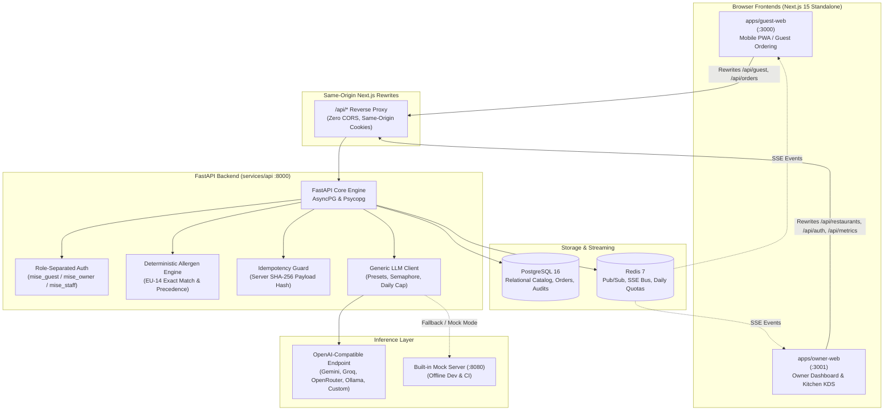

# Mise — Restaurant Revenue Copilot & Kitchen Operations Platform

Mise is an autonomous operational and revenue optimization platform engineered for independent restaurants. Guests scan table QR codes to access a high-performance web menu with deterministic allergen filtering, multi-language localization, and instant ordering. Orders flow in real time through an unbuffered Server-Sent Events (SSE) kitchen display system (KDS). Behind the scenes, restaurant owners receive AI-driven daily operational briefs, scenario margin simulations, and visual menu ingestion.

---

## Features

- **Guest Mobile Web Ordering (`guest-web`)**
  - QR-driven table session initialization.
  - Multi-language support (English, Italian, French, Spanish, German).
  - Deterministic EU-14 allergen cross-referencing with explicit acknowledgment guards.
  - Cart persistence with server-verified idempotency tokens.
  - Live order status tracking powered by Server-Sent Events (SSE).
  - Contextual AI concierge chat assistant.

- **Kitchen Display System (`owner-web`)**
  - Low-latency, high-contrast KDS optimized for busy kitchen lines.
  - Real-time SSE order streaming with automatic reconnection and polling fallbacks.
  - High-visibility allergy alert banners extracted from immutable order item snapshots.
  - Color-coded ticket aging indicators (green < 5m, yellow < 15m, red >= 15m).
  - Idempotent ticket bump workflow with a 60-second undo recall safety window.

- **Owner Revenue Copilot (`owner-web`)**
  - Live revenue metrics, margin tracking, and shift volume tracking.
  - AI daily operations briefing predicting peak demand curves and prep bottlenecks.
  - Interactive scenario simulator (weekend dinner rush, weather shifts, banquets).
  - Visual Menu Ingestion (VLM) for digitizing paper menus from photo URLs into structured catalog items.
  - Table management and high-resolution QR code generator.

---

## Architecture



---

## Screenshots

<!-- Add your application screenshots here -->
| Guest Menu & Allergen Filter | Kitchen Display System (KDS) |
|:---:|:---:|
|  |  |
| *Interactive multi-lingual menu with EU-14 dietary filters* | *Real-time ticket stream with prominent allergy banners* |

| Daily Operations Brief | AI Scenario Simulator |
|:---:|:---:|
|  |  |
| *Hourly cover distribution and prep recommendations* | *Turnover, margin, and kitchen line throughput modeling* |

---

## Quick Start

### Prerequisites

- **Docker & Docker Compose** (v2+)
- **Node.js 22 LTS** & **pnpm 9** (`corepack enable`)
- **Python 3.11** & **uv** (`pip install uv`)

### 1. Clone & Configure Environment

```bash
cp .env.example .env
```

### 2. Boot Full Stack

```bash
# Start all services with health checks
docker compose up -d --build --wait

# Run database migrations
make migrate

# Seed initial restaurant menu and tables
make seed
```

### 3. Access Services

- **Guest Web & Live Demo**: [http://localhost:3000](http://localhost:3000)
- **Owner Dashboard & Login**: [http://localhost:3001](http://localhost:3001)
- **Kitchen Display System**: [http://localhost:3001/kitchen](http://localhost:3001/kitchen)
- **API Health & Documentation**: [http://localhost:8000/health](http://localhost:8000/health)

---

## Environment Variables

| Variable | Default | Purpose |
|----------|---------|---------|
| `APP_ENV` | `dev` | Application environment (`dev`, `staging`, `production`). In non-dev, boot fails if default secrets are unchanged. |
| `API_SECRET_KEY` | `change_me_in_production` | HMAC secret for signing auth session cookies. |
| `OWNER_API_KEY` | `change_me_in_production` | Master key for restaurant owner management. |
| `STAFF_PIN` | `0000` | 4-digit PIN for kitchen staff terminal authentication. |
| `POSTGRES_HOST` / `POSTGRES_DB` | `postgres` / `mise` | PostgreSQL connection coordinates. |
| `REDIS_URL` | `redis://redis:6379/0` | Redis connection URL for pub/sub and rate limiting. |
| `LLM_PROVIDER` | `mock` | `mock` (internal fast mock server) or `openai_compatible`. |
| `LLM_PRESET` | `custom` | Provider preset (`gemini`, `groq`, `openrouter`, `ollama`, `custom`). |
| `LLM_PROVIDER_LABEL` | `OpenAI-compatible endpoint` | Friendly display name shown in metrics and UI. |
| `LLM_FREE_ONLY` | `true` | Policy guard: enforces free-tier restrictions and model naming. |
| `LLM_DAILY_REQUEST_CAP` | `200` | Max daily inference calls for non-local providers. |
| `LLM_BASE_URL` | `http://inference:8080/v1` | Base URL for LLM chat completion endpoints. |
| `LLM_MODEL` | `mock-llm` | Configured text model identifier. |
| `VLM_BASE_URL` | `http://inference:8080/v1` | Base URL for vision/multimodal endpoints. |
| `VLM_MODEL` | `mock-vlm` | Configured vision model identifier. |
| `LLM_GLOBAL_RPM` | `15` | Global requests-per-minute ceiling enforced in Redis. |

---

## Free LLM Options

Mise follows a strict **Free-Only Policy** (`LLM_FREE_ONLY=true`). The project never requires a paid subscription or default credit card. Five provider presets are supported out of the box:

> [!WARNING]
> **Privacy Note on Free LLM Tiers:**
> Free API tiers provided by cloud AI vendors may use submitted prompts to train or improve their models. To protect diner privacy, Mise operates under an **air-gapped privacy design**:
> - Only **synthetic business data** (e.g. hypothetical turnover simulations, public dish descriptions) is ever processed by LLMs.
> - **Real guest personal data, diner contact information, and guest allergy profiles are NEVER sent to LLMs.** Allergen cross-checking is performed entirely on your local server via deterministic database set operations.

### Provider Presets

#### 1. Google Gemini (`LLM_PRESET=gemini`)
- **Setup**: Create a free API key at [Google AI Studio](https://aistudio.google.com).
- **Environment**:
  ```bash
  LLM_PROVIDER=openai_compatible
  LLM_PRESET=gemini
  LLM_PROVIDER_LABEL="Google Gemini"
  LLM_BASE_URL=https://generativelanguage.googleapis.com/v1beta/openai
  VLM_BASE_URL=https://generativelanguage.googleapis.com/v1beta/openai
  LLM_MODEL=gemini-2.0-flash
  VLM_MODEL=gemini-2.0-flash
  LLM_API_KEY=your_gemini_api_key
  LLM_GLOBAL_RPM=10
  ```

#### 2. Groq (`LLM_PRESET=groq`)
- **Setup**: Create a free API key at [Groq Console](https://console.groq.com).
- **Environment**:
  ```bash
  LLM_PROVIDER=openai_compatible
  LLM_PRESET=groq
  LLM_PROVIDER_LABEL="Groq Cloud"
  LLM_BASE_URL=https://api.groq.com/openai/v1
  VLM_BASE_URL=https://api.groq.com/openai/v1
  LLM_MODEL=llama-3.3-70b-versatile
  VLM_MODEL=llama-3.2-11b-vision-preview
  LLM_API_KEY=gsk_your_groq_api_key
  LLM_GLOBAL_RPM=20
  ```

#### 3. OpenRouter Free Tier (`LLM_PRESET=openrouter`)
- **Setup**: Sign up at [OpenRouter](https://openrouter.ai).
- **Policy Enforcement**: Under `LLM_FREE_ONLY=true`, the model name **must end with `:free`** (e.g. `meta-llama/llama-3.3-70b-instruct:free`). The API refuses to boot if a non-free model is configured.
- **Environment**:
  ```bash
  LLM_PROVIDER=openai_compatible
  LLM_PRESET=openrouter
  LLM_PROVIDER_LABEL="OpenRouter Free Tier"
  LLM_BASE_URL=https://openrouter.ai/api/v1
  VLM_BASE_URL=https://openrouter.ai/api/v1
  LLM_MODEL=meta-llama/llama-3.3-70b-instruct:free
  VLM_MODEL=meta-llama/llama-3.2-11b-vision-instruct:free
  LLM_API_KEY=sk-or-v1-your_openrouter_api_key
  LLM_GLOBAL_RPM=15
  ```

#### 4. Ollama Local Private Server (`LLM_PRESET=ollama`)
- **Setup**: Install [Ollama](https://ollama.com) on your machine. Pull your desired models (e.g., `ollama pull llama3.2` and `ollama pull llava`). Run `ollama serve`.
- **Environment**:
  ```bash
  LLM_PROVIDER=openai_compatible
  LLM_PRESET=ollama
  LLM_PROVIDER_LABEL="Ollama Local"
  LLM_BASE_URL=http://localhost:11434/v1
  VLM_BASE_URL=http://localhost:11434/v1
  LLM_MODEL=llama3.2
  VLM_MODEL=llava
  LLM_API_KEY=""
  LLM_CONCURRENCY_LIMIT=2
  ```
  *Note: Local Ollama instances have zero daily quota caps and zero external telemetry.*

#### 5. Custom OpenAI-Compatible Endpoint (`LLM_PRESET=custom`)
- Point to any self-hosted or proxy endpoint adhering to the OpenAI `/v1/chat/completions` specification.

---

## Testing & Quality Assurance

Mise features a comprehensive automated test pyramid covering unit, contract, and cross-framework integration tests.

```bash
# Run Ruff linting and formatting checks
uv run --project services/api ruff check services/ scripts/
uv run --project services/api ruff format --check services/ scripts/

# Run Next.js / TypeScript linting
pnpm -r lint

# Run all unit and integration tests (Pytest + Vitest)
make test

# Run repo branding and hygiene audit
bash scripts/check_branding.sh

# Complete CI pipeline
make ci
```

---

## Security & Reliability Notes

1. **Deterministic Allergen Safety**: Food allergies can be life-threatening. Mise never relies on generative models or fuzzy embeddings to evaluate dietary risks. Menu items are checked with exact set theory against the EU-14 regulatory allergen catalog.
2. **Server-Side Idempotency**: Flaky mobile restaurant Wi-Fi can trigger duplicate network requests. Mise computes a deterministic SHA-256 payload hash on the server. If an identical `idempotency_key` is re-sent, the existing order is returned without duplicating tickets.
3. **Role-Separated Signed Cookies**: All session states (`mise_guest`, `mise_owner`, `mise_staff`) use signed, httpOnly cookies with strict SameSite configurations, isolating guest browser contexts from operational restaurant management.
4. **Daily Request Safeguards**: Non-local AI provider usage is capped via Redis UTC day keys (`LLM_DAILY_REQUEST_CAP`). When the cap or provider 429 limits are reached, the system falls back gracefully with HTTP 503 `ai_unavailable` while dining and kitchen operations proceed without interruption.

---

## Roadmap

- [ ] **Table-Side Payment Integrations**: Stripe Terminal and Apple Pay web-checkout hooks.
- [ ] **Inventory Depletion Engine**: Real-time 86'ing of menu items when kitchen stock runs low.
- [ ] **Audio KDS Annunciations**: Web Audio synthesized spoken ticket callouts for kitchen expediters.
- [ ] **Multi-Location Hierarchy**: Master tenant dashboard for multi-unit restaurant groups.

---

## License

MIT © 2026 <YOUR NAME>
