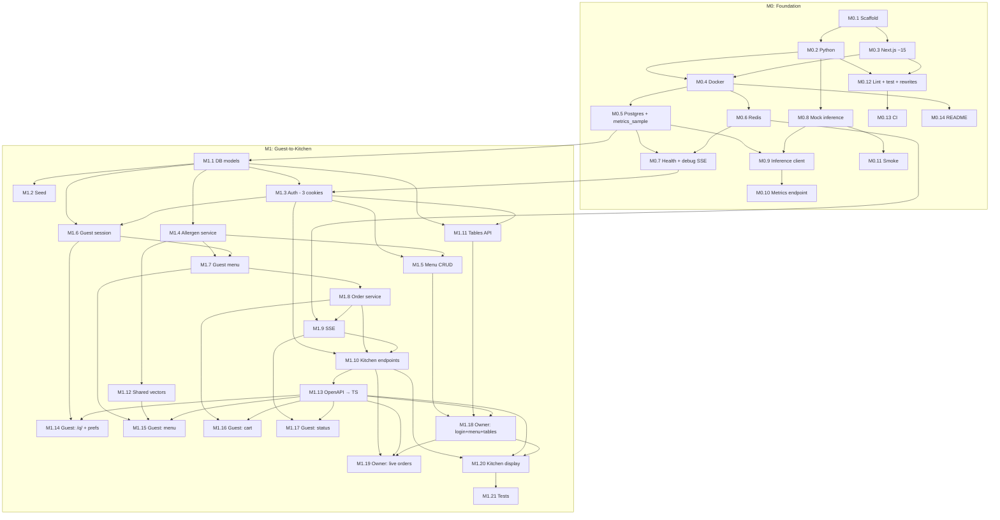

# Mise — Phase 0 Implementation Plan (M0 + M1)

> **Status:** M0 IN PROGRESS
> **Date:** 2026-10-09 (rev 3)
> **Project Type:** WEB (multi-service, Python backend + Next.js frontends)
> **Hackathon:** AMD Developer Hackathon ACT III, Track 3 — Reinvent Commerce

---

## Rev 3 Changelog (v2 → v3)

1. **Guest cookie** — Signed httpOnly `mise_guest` cookie (SameSite=Lax) set at session creation. Order endpoints + SSE verify ownership via cookie.
2. **Server-side payload hash** — Client sends only `idempotency_key`. Server computes canonical `payload_hash`. Same key + different payload → 409.
3. **Allergen safety hardened** — `CHECK (allergens <@ EU_14)`; arrays `NOT NULL DEFAULT '{}'`; status precedence `contains > unverified > no_declared_match` pinned in shared vectors; snapshot `allergens_to_avoid` + `dietary_preferences` on `orders`; snapshot allergens, verified flag, status on `order_item`; kitchen reads snapshots; recompute + require explicit `allergen_acknowledgment` at order placement; audit allergen ack and owner edits; vegan/vegetarian vs allergen CHECK constraints.
4. **Session flow** — Collect language + diets + allergens before POST. Added `PATCH /api/guest/session`.
5. **Owner live orders** — `GET` list for initial load, reconnect, poll. Owner role also allowed on kitchen list.
6. **Tests** — Polling/reconnect tests → Vitest (use-sse). Negative tests: no `unit_cost` in guest schema, cross-session isolation, 401/403, verified flag reset, constraint rejection.
7. **Security** — Restricted rewrites per app. Rate-limited login. `APP_ENV` guard on default secrets. Metrics require owner auth. Postgres/Redis ports dev-only.
8. **SSE proxy** — `middleware.ts` → `src/middleware.ts`. Pin Next ~15. Note `proxy.ts` for 16. 15 s heartbeat. Raised rewrite timeout. Debug SSE endpoint in M0. Caddy fallback service.
9. **Make targets** — `down` keeps volumes; `reset` drops them. Tests use `run --rm`. OpenAPI uses `exec -T`. CI starts only Postgres + Redis.
10. **Health** — `127.0.0.1` in checks. `HOSTNAME=0.0.0.0`. `API_URL` build arg for rewrites.
11. **Drop publish** — No `menu_version`, no publish endpoint in M1. Edits are live.
12. **Status simplified** — `placed | bumped | cancelled` (TEXT + CHECK). Recall allowed (`bumped` → `placed`) strictly within 60 s (< 60 s) of `bumped_at` (emits `order_recalled` audit event). `bumped` → "Ready" for guests.
13. **Graph fixes** — M1.3→M1.10, M1.18→M1.19+M1.20, frontend routes→M1.13.
14. **Order limits** — `quantity` 1–20, max 50 line items, `notes` max 500 chars.

---

## 1. Overview

| Milestone | Goal | AI? |
|-----------|------|-----|
| **M0 — Foundation** | Docker Compose boots all services. Mock inference works. Metrics pipeline writes to `metrics_sample`. Debug SSE endpoint proves proxy streaming. CI passes. | No |
| **M1 — Guest-to-Kitchen** | Guest scans QR → sets preferences → browses → orders (with allergen ack) → kitchen sees live orders with allergy flags → bumps. Owner logs in, edits menu, sees live orders, prints QR codes. | No |

---

## 2. Success Criteria

### M0

- [ ] `docker compose up` → postgres, redis, api, guest-web, owner-web, inference all healthy (health checks use `127.0.0.1`)
- [ ] `GET /health` → `{"status":"ok","db":"ok","redis":"ok"}`
- [ ] `GET /debug/sse` streams heartbeat through both Next.js proxies without buffering
- [ ] `make smoke` → validates structured JSON from mock, prints tokens/s + latency
- [ ] `metrics_sample` table exists; `/api/metrics/inference` returns data (owner auth enforced later)
- [ ] Both Next.js apps proxy **only their allowed paths** to FastAPI
- [ ] `APP_ENV=production` + default secrets → server refuses to start
- [ ] `make lint` and `make test` pass; `make ci` passes
- [ ] Postgres/Redis ports not published in production compose (only in override)

### M1

- [ ] All M1 tables created (no forecast/recommendation/action). Allergen CHECK constraints enforced.
- [ ] Seed loads ~25 items. Arrays NOT NULL, EU-14 validated.
- [ ] Three cookies: `mise_owner`, `mise_staff`, `mise_guest`. Login rate-limited. Guest can't access owner/staff endpoints (401/403).
- [ ] Guest creates session (language + diets + allergens collected first). PATCH updates preferences.
- [ ] Guest menu excludes `unit_cost`. Each item has `allergen_status` with precedence `contains > unverified > no_declared_match`.
- [ ] Order placement: server computes payload hash; recomputes allergen status; requires `allergen_acknowledgment` for conflicts/unverified; writes audit_log; snapshots session prefs + item allergens on order_item.
- [ ] Kitchen tickets show allergy flags **from order_item snapshot**. Bump idempotent (`bumped_at`). Recall allowed strictly within 60 s (< 60 s) of `bumped_at` (`order_recalled` audit event). Kitchen UI recall button for the last bumped order. Guest sees "Ready".
- [ ] Order limits enforced: qty 1–20, max 50 lines, notes ≤ 500 chars.
- [ ] Shared allergen test vectors run in pytest AND vitest. Negative tests pass.
- [ ] Owner edits to allergen/dietary fields: verified flags auto-reset + audit_log row.
- [ ] Menu edits are live immediately (no publish/version).

---

## 3. Architecture Decisions (Locked)

| Decision | Choice | Rationale |
|----------|--------|-----------|
| Frontend | **Two Next.js ~15 apps**: guest-web + owner-web | Guest bundle tiny. Pin major version. Note `proxy.ts` if Next 16. |
| API proxy | Each app rewrites **only its allowed `/api/*` paths** → `http://api:8000` | Same-origin. No CORS. No build-time URL. `API_URL` passed as Docker build arg. |
| Auth cookies | `mise_owner` (owner), `mise_staff` (staff), `mise_guest` (guest). All httpOnly, signed. Guest: SameSite=Lax. | Separate names. Cookie-verified ownership on orders + SSE. |
| Kitchen layout | Route groups `(dashboard)` + `(kitchen)` in owner-web | Truly separate bundles. |
| ORM | SQLAlchemy 2.0 + Alembic. asyncpg (runtime), psycopg (migrations). | |
| SSE | 15 s heartbeat. Generators never hold DB session. Publish after commit. Raised proxy timeout. Debug endpoint in M0. **Caddy fallback** if proxy buffers. | |
| Allergen model | Server-authoritative. `contains > unverified > no_declared_match`. Never "safe". Snapshots on order. Acknowledgment required. | |
| Order status | `placed \| bumped \| cancelled` (TEXT + CHECK). Recall (`bumped` → `placed`) strictly within 60 s (< 60 s) of `bumped_at` (`order_recalled` audit event). Kitchen UI recall button for last bumped order. `bumped` → "Ready" for guest. | Simplest correct model with safety recall window. |
| Payload hash | **Server-computed**. Client sends only `idempotency_key`. | Single source of truth for hash. |
| Publish/version | **Deferred to M2**. Edits live in M1. | Simpler M1 scope. |
| Secrets | `APP_ENV != dev` → refuse default values for `API_SECRET_KEY`, `OWNER_API_KEY`, `STAFF_PIN`. | |
| Ports | Postgres (5432) and Redis (6379) published **only in dev override**. | Production safety. |
| Health checks | Use `127.0.0.1` (not `localhost`). Set `HOSTNAME=0.0.0.0` in containers. | IPv6 ambiguity avoidance. |
| Tests | Real Postgres. `docker compose run --rm`. CI starts only postgres + redis. | |
| Make targets | `down` keeps volumes. `reset` drops them. `exec -T` for piped output. | |
| `middleware.ts` | At `src/middleware.ts` (not root). | Next.js src/ convention. |
| Tailwind v4 | CSS-first. `postcss.config.mjs`. No `tailwind.config.*`. | |
| Deferred stubs | forecast, recommendation, action tables in **M2**. | No dead schema. |
| Line endings | `.gitattributes` forces LF. | |

---

## 4. Tech Stack

### Backend (Python 3.11)

| Tool | Version |
|------|---------|
| FastAPI | 0.115+ |
| uvicorn | latest |
| SQLAlchemy 2.0 | 2.0+ |
| Alembic | 1.13+ |
| asyncpg | 0.30+ |
| psycopg | 3.2+ |
| Pydantic v2 | 2.9+ |
| redis-py (async) | 5.0+ |
| httpx | latest |
| pytest, pytest-asyncio | latest |
| ruff | 0.8+ |
| uv | 0.5+ |

### Frontend (TypeScript)

| Tool | Version |
|------|---------|
| Next.js (App Router) | ~15 (pin major) |
| TypeScript | 5.6+ |
| Tailwind CSS v4 (CSS-first) | 4.0+ |
| Vitest + Testing Library | latest |
| eslint + typescript-eslint | latest |
| openapi-fetch + openapi-typescript | latest |
| Node | 22 LTS |
| pnpm | 9+ (corepack) |

### Infrastructure

| Component | Image |
|-----------|-------|
| Postgres | postgres:16-alpine |
| Redis | redis:7-alpine |
| Mock inference | Custom FastAPI |
| Caddy (fallback) | caddy:2-alpine |

---

## 5. Database Schema

> All timestamps **TIMESTAMPTZ**. All tables: `id` UUID PK, `created_at`, `updated_at` unless noted. All allergen/dietary arrays **NOT NULL DEFAULT '{}'**.

### EU-14 allergen literal set

```sql
'gluten','milk','eggs','fish','crustaceans','molluscs',
'tree_nuts','peanuts','soy','celery','mustard','sesame','sulphites','lupin'
```

### Allowed dietary preferences set

```sql
'vegetarian','vegan','gluten_free'
```

### restaurant

| Column | Type | Notes |
|--------|------|-------|
| id | UUID | PK, default `gen_random_uuid()` |
| name | TEXT | NOT NULL |
| slug | TEXT | UNIQUE NOT NULL |
| timezone | TEXT | `Europe/Rome` |
| currency | TEXT | `EUR` |
| active | BOOLEAN | default true |
| languages | TEXT[] | NOT NULL DEFAULT `'{en}'` |
| default_language | TEXT | NOT NULL DEFAULT `'en'` |
| menu_version | INTEGER | NOT NULL DEFAULT 0 (unused in M1) |
| onboarding | JSONB | M2+ cold-start |
| created_at | TIMESTAMPTZ | NOT NULL DEFAULT `now()` |
| updated_at | TIMESTAMPTZ | NOT NULL DEFAULT `now()` |

**CHECK constraints:**
```sql
CHECK ((default_language = ANY(languages)) IS TRUE)
```

### menu_item

| Column | Type | Notes |
|--------|------|-------|
| id | UUID | PK, default `gen_random_uuid()` |
| restaurant_id | UUID | FK → `restaurant(id)` ON DELETE CASCADE |
| category | TEXT | NOT NULL |
| price | DECIMAL(10,2) | NOT NULL (`CHECK (price >= 0)`) |
| unit_cost | DECIMAL(10,2) | NOT NULL (`CHECK (unit_cost >= 0)`). **Excluded from guest schemas.** |
| ingredients | TEXT[] | NOT NULL DEFAULT '{}' |
| allergens | TEXT[] | NOT NULL DEFAULT '{}' |
| allergen_verified | BOOLEAN | NOT NULL DEFAULT false. Auto-reset on allergen/ingredient change. |
| is_vegetarian | BOOLEAN | NOT NULL DEFAULT false |
| is_vegan | BOOLEAN | NOT NULL DEFAULT false |
| is_gluten_free | BOOLEAN | NOT NULL DEFAULT false |
| dietary_verified | BOOLEAN | NOT NULL DEFAULT false. Auto-reset on dietary change. |
| available | BOOLEAN | NOT NULL DEFAULT true |
| featured | BOOLEAN | NOT NULL DEFAULT false |
| sort_order | INTEGER | NOT NULL DEFAULT 0 |
| image_url | TEXT | Nullable |
| deleted_at | TIMESTAMPTZ | Nullable. Soft-delete. |
| created_at | TIMESTAMPTZ | NOT NULL DEFAULT `now()` |
| updated_at | TIMESTAMPTZ | NOT NULL DEFAULT `now()` |

*Note: Item creation transactionally requires creating a `menu_translation` matching `restaurant.default_language`.*

**CHECK constraints:**

```sql
-- Allergens must be EU-14 values
CHECK (allergens <@ ARRAY['gluten','milk','eggs','fish','crustaceans','molluscs',
       'tree_nuts','peanuts','soy','celery','mustard','sesame','sulphites','lupin']::text[])

-- Vegan implies vegetarian
CHECK (NOT (is_vegan AND NOT is_vegetarian))

-- Gluten-free contradicts gluten allergen
CHECK (NOT (is_gluten_free AND 'gluten' = ANY(allergens)))

-- Vegan contradicts animal-product allergens
CHECK (NOT is_vegan OR NOT (allergens && ARRAY['milk','eggs','fish','crustaceans','molluscs']::text[]))

-- Vegetarian contradicts flesh-based allergens
CHECK (NOT is_vegetarian OR NOT (allergens && ARRAY['fish','crustaceans','molluscs']::text[]))

-- Price non-negative
CHECK (price >= 0 AND unit_cost >= 0)
```

### menu_translation

| Column | Type | Notes |
|--------|------|-------|
| id | UUID | PK, default `gen_random_uuid()` |
| menu_item_id | UUID | FK → `menu_item(id)` ON DELETE CASCADE |
| language | TEXT | NOT NULL |
| name | TEXT | NOT NULL |
| description | TEXT | Nullable |
| created_at | TIMESTAMPTZ | NOT NULL DEFAULT `now()` |
| updated_at | TIMESTAMPTZ | NOT NULL DEFAULT `now()` |

**Constraints:** `UNIQUE (menu_item_id, language)`

### dining_table

| Column | Type | Notes |
|--------|------|-------|
| id | UUID | PK, default `gen_random_uuid()` |
| restaurant_id | UUID | FK → `restaurant(id)` ON DELETE CASCADE |
| label | TEXT | NOT NULL |
| qr_token | TEXT | UNIQUE NOT NULL |
| created_at | TIMESTAMPTZ | NOT NULL DEFAULT `now()` |
| updated_at | TIMESTAMPTZ | NOT NULL DEFAULT `now()` |

### guest_session

| Column | Type | Notes |
|--------|------|-------|
| id | UUID | PK, default `gen_random_uuid()` |
| restaurant_id | UUID | FK → `restaurant(id)` ON DELETE CASCADE |
| table_id | UUID | FK → `dining_table(id)` ON DELETE SET NULL, nullable |
| language | TEXT | NOT NULL |
| dietary_preferences | TEXT[] | NOT NULL DEFAULT '{}' |
| allergens_to_avoid | TEXT[] | NOT NULL DEFAULT '{}' |
| expires_at | TIMESTAMPTZ | NOT NULL |
| created_at | TIMESTAMPTZ | NOT NULL DEFAULT `now()` |
| updated_at | TIMESTAMPTZ | NOT NULL DEFAULT `now()` |

```sql
CHECK (allergens_to_avoid <@ ARRAY['gluten','milk','eggs','fish','crustaceans','molluscs',
       'tree_nuts','peanuts','soy','celery','mustard','sesame','sulphites','lupin']::text[])
CHECK (dietary_preferences <@ ARRAY['vegetarian','vegan','gluten_free']::text[])
```

### orders

| Column | Type | Notes |
|--------|------|-------|
| id | UUID | PK, default `gen_random_uuid()` |
| guest_session_id | UUID | FK → `guest_session(id)` **ON DELETE RESTRICT** |
| restaurant_id | UUID | FK → `restaurant(id)` ON DELETE CASCADE |
| table_id | UUID | FK → `dining_table(id)` ON DELETE SET NULL, nullable |
| status | TEXT | NOT NULL DEFAULT 'placed' |
| total | DECIMAL(10,2) | NOT NULL (`CHECK (total >= 0)`) |
| idempotency_key | TEXT | NOT NULL |
| payload_hash | TEXT | NOT NULL. **Server-computed.** |
| allergen_conflict_acknowledged | BOOLEAN | NOT NULL DEFAULT false |
| allergens_to_avoid | TEXT[] | NOT NULL DEFAULT '{}'. **Snapshot from session.** |
| dietary_preferences | TEXT[] | NOT NULL DEFAULT '{}'. **Snapshot from session.** |
| placed_at | TIMESTAMPTZ | NOT NULL DEFAULT `now()` |
| bumped_at | TIMESTAMPTZ | Nullable. Idempotent bump. |
| created_at | TIMESTAMPTZ | NOT NULL DEFAULT `now()` |
| updated_at | TIMESTAMPTZ | NOT NULL DEFAULT `now()` |

```sql
CHECK (status IN ('placed', 'bumped', 'cancelled'))
CHECK (total >= 0)
CHECK (allergens_to_avoid <@ ARRAY['gluten','milk','eggs','fish','crustaceans','molluscs',
       'tree_nuts','peanuts','soy','celery','mustard','sesame','sulphites','lupin']::text[])
CHECK (dietary_preferences <@ ARRAY['vegetarian','vegan','gluten_free']::text[])
UNIQUE (guest_session_id, idempotency_key)
```

**Status transitions & Recall:**

```
placed → bumped   (kitchen clears order; guest sees "Ready")
bumped → placed   (recall allowed strictly within 60 s (< 60 s) of bumped_at; >= 60 s rejected, no audit event)
placed → cancelled
```

### order_item

| Column | Type | Notes |
|--------|------|-------|
| id | UUID | PK, default `gen_random_uuid()` |
| order_id | UUID | FK → `orders(id)` ON DELETE CASCADE |
| menu_item_id | UUID | FK → `menu_item(id)` ON DELETE RESTRICT |
| quantity | INTEGER | NOT NULL (`CHECK (quantity >= 1 AND quantity <= 20)`) |
| unit_price | DECIMAL(10,2) | Snapshot (`CHECK (unit_price >= 0)`) |
| unit_cost | DECIMAL(10,2) | Snapshot (`CHECK (unit_cost >= 0)`) |
| item_name | TEXT | NOT NULL. Snapshot in guest language. |
| kitchen_name | TEXT | NOT NULL. Snapshot in restaurant default language. |
| allergens | TEXT[] | NOT NULL DEFAULT '{}'. **Snapshot.** |
| allergen_verified | BOOLEAN | NOT NULL. **Snapshot.** |
| allergen_status | TEXT | NOT NULL. **Computed at order time.** |
| notes | TEXT | Nullable |
| created_at | TIMESTAMPTZ | NOT NULL DEFAULT `now()` |

```sql
CHECK (quantity >= 1 AND quantity <= 20)
CHECK (unit_price >= 0 AND unit_cost >= 0)
CHECK (notes IS NULL OR length(notes) <= 500)
CHECK (allergen_status IN ('contains', 'unverified', 'no_declared_match'))
CHECK (allergens <@ ARRAY['gluten','milk','eggs','fish','crustaceans','molluscs',
       'tree_nuts','peanuts','soy','celery','mustard','sesame','sulphites','lupin']::text[])
```

Application-level: max 50 `order_item` rows per order.

### audit_log

| Column | Type | Notes |
|--------|------|-------|
| id | UUID | PK, default `gen_random_uuid()` |
| restaurant_id | UUID | FK → `restaurant(id)` ON DELETE CASCADE |
| event_type | TEXT | NOT NULL |
| actor | TEXT | NOT NULL |
| payload | JSONB | NOT NULL DEFAULT `'{}'::jsonb` |
| created_at | TIMESTAMPTZ | NOT NULL DEFAULT `now()`. No updated_at. |

Event types: `allergen_conflict_acknowledged`, `owner_allergen_edit`, `owner_dietary_edit`, `order_placed`, `order_bumped`, `order_recalled`, `menu_item_deleted`.

### metrics_sample (M0)

| Column | Type | Notes |
|--------|------|-------|
| id | UUID | PK, default `gen_random_uuid()` (0002 migration) |
| model | TEXT | NOT NULL |
| endpoint | TEXT | NOT NULL |
| tokens_in | INTEGER | NOT NULL |
| tokens_out | INTEGER | NOT NULL |
| latency_ms | INTEGER | NOT NULL |
| gpu_seconds | FLOAT | Nullable |
| cached_prefix_tokens | INTEGER | Nullable |
| created_at | TIMESTAMPTZ | NOT NULL DEFAULT `now()`. No updated_at. |

### Explicit Indexes & Foreign Key Indexes

| Table | Index Name | Columns / Definition | Purpose |
|-------|------------|----------------------|---------|
| `restaurant` | `restaurant_pkey` | `(id)` PRIMARY KEY | PK lookup |
| `restaurant` | `restaurant_slug_key` | `(slug)` UNIQUE | Slug routing |
| `menu_item` | `menu_item_pkey` | `(id)` PRIMARY KEY | PK lookup |
| `menu_item` | `idx_menu_item_restaurant_id` | `(restaurant_id)` | FK index |
| `menu_item` | `idx_menu_item_active` | `(restaurant_id) WHERE deleted_at IS NULL` | Active menu items |
| `menu_item` | `idx_menu_item_listing` | `(restaurant_id, available, sort_order) WHERE deleted_at IS NULL` | Public menu listing |
| `menu_translation` | `menu_translation_pkey` | `(id)` PRIMARY KEY | PK lookup |
| `menu_translation` | `idx_menu_translation_item_id`| `(menu_item_id)` | FK index |
| `menu_translation` | `menu_translation_item_lang_key` | `(menu_item_id, language)` UNIQUE | Language resolution |
| `dining_table` | `dining_table_pkey` | `(id)` PRIMARY KEY | PK lookup |
| `dining_table` | `idx_dining_table_restaurant_id` | `(restaurant_id)` | FK index |
| `dining_table` | `dining_table_qr_token_key` | `(qr_token)` UNIQUE | QR scan resolution |
| `guest_session` | `guest_session_pkey` | `(id)` PRIMARY KEY | PK lookup |
| `guest_session` | `idx_guest_session_restaurant_id` | `(restaurant_id)` | FK index |
| `guest_session` | `idx_guest_session_table_id` | `(table_id)` | FK index |
| `guest_session` | `idx_guest_session_cleanup` | `(restaurant_id, expires_at)` | Session expiry sweep |
| `orders` | `orders_pkey` | `(id)` PRIMARY KEY | PK lookup |
| `orders` | `idx_orders_restaurant_id` | `(restaurant_id)` | FK index |
| `orders` | `idx_orders_guest_session_id` | `(guest_session_id)` | FK index |
| `orders` | `idx_orders_table_id` | `(table_id)` | FK index |
| `orders` | `orders_guest_idempotency_key` | `(guest_session_id, idempotency_key)` UNIQUE | Idempotency guard |
| `orders` | `idx_orders_kitchen_query` | `(restaurant_id, status, placed_at)` | Kitchen active queue |
| `order_item` | `order_item_pkey` | `(id)` PRIMARY KEY | PK lookup |
| `order_item` | `idx_order_item_order_id` | `(order_id)` | FK index |
| `order_item` | `idx_order_item_menu_item_id` | `(menu_item_id)` | FK index |
| `audit_log` | `audit_log_pkey` | `(id)` PRIMARY KEY | PK lookup |
| `audit_log` | `idx_audit_log_restaurant_id` | `(restaurant_id)` | FK index |
| `audit_log` | `idx_audit_log_query` | `(restaurant_id, event_type, created_at)` | Audit queries |
| `metrics_sample` | `metrics_sample_pkey` | `(id)` PRIMARY KEY | PK lookup |
| `metrics_sample` | `idx_metrics_sample_model_created` | `(model, created_at)` | Inference metrics aggregation |

---

## 6. Directory Tree

```
mise/
├── .gitattributes                    # * text=auto eol=lf
├── .gitignore
├── .nvmrc                            # 22
├── .env.example
├── README.md
├── Makefile
├── package.json                      # pnpm workspace root
├── pnpm-workspace.yaml
├── docker-compose.yml                # Postgres/Redis ports NOT published
├── docker-compose.override.yml       # Dev: volumes, hot reload, published ports
├── Caddyfile                         # SSE proxy fallback (see docs)
│
├── apps/
│   ├── guest-web/
│   │   ├── Dockerfile                # context: repo root, ARG API_URL
│   │   ├── next.config.ts            # rewrites: /api/guest/*, /api/orders/*, /health, /debug/sse
│   │   ├── postcss.config.mjs
│   │   ├── tsconfig.json
│   │   ├── package.json              # next: "~15.x"
│   │   └── src/
│   │       ├── app/
│   │       │   ├── layout.tsx
│   │       │   ├── page.tsx
│   │       │   ├── q/[token]/page.tsx      # QR → collect prefs → POST session → redirect
│   │       │   └── [lang]/
│   │       │       ├── layout.tsx
│   │       │       ├── page.tsx
│   │       │       ├── menu/page.tsx
│   │       │       ├── cart/page.tsx
│   │       │       └── order/[orderId]/page.tsx
│   │       ├── components/                  # (unchanged from v2)
│   │       ├── hooks/
│   │       │   ├── use-sse.ts               # 15 s heartbeat expected, poll fallback
│   │       │   ├── use-cart.ts              # idempotency key only (no client hash)
│   │       │   └── use-api.ts
│   │       ├── i18n/
│   │       │   ├── en.json
│   │       │   ├── it.json
│   │       │   └── index.ts
│   │       └── lib/
│   │           ├── allergen-filter.ts
│   │           └── constants.ts
│   │
│   └── owner-web/
│       ├── Dockerfile                       # context: repo root, ARG API_URL
│       ├── next.config.ts                   # rewrites: /api/auth/*, /api/restaurants/*, /api/metrics/*, /health, /debug/sse
│       ├── postcss.config.mjs
│       ├── tsconfig.json
│       ├── package.json                     # next: "~15.x"
│       └── src/
│           ├── middleware.ts                 # Auth check (not at root)
│           ├── app/
│           │   ├── layout.tsx
│           │   ├── login/page.tsx
│           │   ├── (dashboard)/
│           │   │   ├── layout.tsx
│           │   │   ├── page.tsx             # / → live orders (GET list + SSE)
│           │   │   ├── menu/page.tsx
│           │   │   ├── menu/[itemId]/page.tsx
│           │   │   └── tables/page.tsx      # QR codes via PUBLIC_GUEST_URL
│           │   └── (kitchen)/
│           │       ├── layout.tsx           # Bare
│           │       └── kitchen/page.tsx     # Allergy flags from snapshot, recall button
│           ├── components/                  # recall-button.tsx, ticket-card.tsx
│           ├── hooks/
│           └── lib/
│
├── packages/
│   └── api-client/                          # openapi-fetch + openapi-typescript
│       ├── openapi.json
│       └── src/
│           ├── generated/
│           └── client.ts
│
├── services/
│   ├── api/
│   │   ├── Dockerfile
│   │   ├── pyproject.toml
│   │   ├── uv.lock
│   │   ├── alembic.ini
│   │   ├── alembic/
│   │   │   ├── env.py                       # psycopg (sync)
│   │   │   └── versions/
│   │   ├── src/
│   │   │   ├── main.py                      # includes /debug/sse
│   │   │   ├── config.py                    # APP_ENV guard on default secrets
│   │   │   ├── database.py
│   │   │   ├── deps.py
│   │   │   ├── models/
│   │   │   │   ├── restaurant.py
│   │   │   │   ├── menu.py
│   │   │   │   ├── dining_table.py
│   │   │   │   ├── session.py
│   │   │   │   ├── order.py
│   │   │   │   ├── audit.py
│   │   │   │   └── metrics.py
│   │   │   ├── schemas/
│   │   │   │   ├── menu.py                  # Owner vs guest (guest excludes unit_cost)
│   │   │   │   ├── order.py                 # allergen_acknowledgment field
│   │   │   │   ├── session.py
│   │   │   │   ├── auth.py
│   │   │   │   ├── health.py
│   │   │   │   └── metrics.py
│   │   │   ├── routers/
│   │   │   │   ├── health.py                # /health + /debug/sse
│   │   │   │   ├── auth.py                  # Rate-limited login
│   │   │   │   ├── menu.py                  # Audit allergen/dietary edits
│   │   │   │   ├── guest.py                 # POST + PATCH session
│   │   │   │   ├── order.py                 # Cookie-verified, server hash, ack
│   │   │   │   ├── kitchen.py               # Bump + recall (<60s, order_recalled audit on success). Owner role allowed on list.
│   │   │   │   └── metrics.py               # Owner auth required
│   │   │   ├── services/
│   │   │   │   ├── auth_service.py          # 3 cookie types
│   │   │   │   ├── menu_service.py          # Auto-reset verified + audit
│   │   │   │   ├── order_service.py         # Server hash, ack, limits, snapshots
│   │   │   │   ├── allergen_service.py      # Precedence: contains > unverified > no_declared_match
│   │   │   │   ├── session_service.py
│   │   │   │   └── sse_service.py
│   │   │   └── inference/
│   │   │       ├── client.py
│   │   │       └── metrics.py
│   │   └── tests/
│   │       ├── conftest.py                  # Real Postgres
│   │       ├── test_allergen_service.py     # Shared vectors
│   │       ├── test_order_service.py        # Idempotency, 409, ack, limits, status
│   │       ├── test_menu_router.py          # Verified flag reset, audit, constraints
│   │       ├── test_guest_router.py         # No unit_cost, PATCH
│   │       ├── test_kitchen_router.py       # Bump idempotent, recall boundary (<60s allowed + audit, >=60s -> 409 and no audit), owner on list, allergy flags
│   │       ├── test_auth.py                 # 401/403, cross-session, rate limit
│   │       ├── test_health.py
│   │       └── test_inference_client.py
│   │
│   └── inference/mock/
│       ├── Dockerfile
│       ├── pyproject.toml
│       └── src/
│           ├── main.py
│           ├── handlers.py
│           └── canned.py
│
├── data/
│   ├── seed/
│   │   ├── trattoria_da_mario.json
│   │   └── README.md
│   └── test-vectors/
│       └── allergen-filter.json             # Precedence pinned; shared pytest + vitest
│
├── scripts/
│   ├── seed.py
│   ├── smoke_inference.py
│   ├── export_openapi.py                    # From app object
│   ├── generate_client.sh
│   └── generate_qr.py
│
├── docs/
│   ├── architecture.md
│   ├── decisions.md                         # Caddy fallback, proxy.ts note
│   └── running.md
│
└── .github/workflows/ci.yml                # Starts only postgres + redis
```

---

## 7. Environment Variables

```bash
# === .env.example ===

# --- App ---
APP_ENV=dev                              # dev | staging | production
                                         # non-dev rejects default secrets

# --- Postgres ---
POSTGRES_HOST=postgres
POSTGRES_PORT=5432
POSTGRES_DB=mise
POSTGRES_USER=mise
POSTGRES_PASSWORD=change_me_in_production

# --- Redis ---
REDIS_URL=redis://redis:6379/0

# --- API ---
API_HOST=0.0.0.0
API_PORT=8000
API_SECRET_KEY=change_me_in_production   # Signs all cookies

# --- Auth ---
OWNER_API_KEY=change_me_in_production
STAFF_PIN=0000

# --- URLs ---
PUBLIC_GUEST_URL=http://localhost:3000    # QR code base URL

# --- Inference ---
LLM_BASE_URL=http://inference:8080/v1
LLM_MODEL=mock-llm
LLM_MAX_TOKENS=1024
LLM_TIMEOUT_SECONDS=30
VLM_BASE_URL=http://inference:8080/v1
VLM_MODEL=mock-vlm

# --- Mock control ---
MOCK_LATENCY_MS=100
MOCK_ERROR_RATE=0.0
MOCK_TIMEOUT_MS=0

# --- GPU cost ---
GPU_HOURLY_RATE_USD=0.00

# --- Demo ---
DEMO_RESTAURANT_SLUG=trattoria-da-mario
```

---

## 8. API Endpoints

### Infrastructure (no auth)

| Method | Path | Purpose |
|--------|------|---------|
| GET | `/health` | DB + Redis ping |
| GET | `/debug/sse` | M0: streams counter every 1 s, tests proxy |

### Auth

| Method | Path | Purpose |
|--------|------|---------|
| POST | `/api/auth/login` | `{role, api_key}` or `{role, pin}` → sets `mise_owner` or `mise_staff` cookie. **Rate-limited.** |
| POST | `/api/auth/logout` | Clears cookie |
| GET | `/api/auth/me` | Current role or 401 |

### Guest (proxied by guest-web)

| Method | Path | Auth | Purpose |
|--------|------|------|---------|
| POST | `/api/guest/session` | None | `{qr_token, language, dietary_preferences, allergens_to_avoid}` → sets `mise_guest` cookie |
| PATCH | `/api/guest/session` | Guest cookie | Update language / prefs |
| GET | `/api/guest/menu` | Guest cookie | Menu in session language. Excludes `unit_cost`. Includes `allergen_status` per item. `?dietary=...` filter. |

**`allergen_status` precedence** (pinned in shared vectors):

| Priority | Status | Condition |
|----------|--------|-----------|
| 1 (highest) | `contains` | Item allergens ∩ guest allergens_to_avoid ≠ ∅ |
| 2 | `unverified` | `allergen_verified = false` (no overlap but unverified) |
| 3 (lowest) | `no_declared_match` | Verified, no overlap. **Not a safety guarantee.** |

### Orders (proxied by guest-web, guest cookie verified)

| Method | Path | Auth | Purpose |
|--------|------|------|---------|
| POST | `/api/orders` | Guest | Place order. Body: `{items, idempotency_key, allergen_acknowledgment?}`. Server computes `payload_hash`. |
| GET | `/api/orders/{id}` | Guest | Own order only |
| GET | `/api/orders/{id}/stream` | Guest | SSE, own order only |

**Idempotency:**

| Scenario | Response |
|----------|----------|
| New `(session_id, key)` | `201` |
| Same `(session_id, key)`, same payload | `200` |
| Same `(session_id, key)`, different payload | `409` |

**Allergen acknowledgment:** If any order item has status `contains` or `unverified`, `allergen_acknowledgment` (list of those item IDs) must be present. Missing → `422` with conflicting items. On ack → `audit_log` row.

### Kitchen (proxied by owner-web)

| Method | Path | Auth | Purpose |
|--------|------|------|---------|
| GET | `/api/restaurants/{slug}/kitchen/orders` | Staff **or Owner** | Active orders with allergy flags **from order_item snapshot** |
| GET | `/api/restaurants/{slug}/kitchen/stream` | Staff | SSE |
| POST | `/api/restaurants/{slug}/kitchen/orders/{id}/bump` | Staff | Idempotent: sets `bumped_at`, status→bumped. Already bumped → 200 with existing `bumped_at`. |
| POST | `/api/restaurants/{slug}/kitchen/orders/{id}/recall` | Staff | Recall strictly within 60 s (`now() - bumped_at < '60 seconds'::interval`): status `bumped` → `placed`, emits `order_recalled` audit event. Requests at >= 60 s rejected with 409 Conflict (no audit event emitted). |

### Menu (proxied by owner-web)

| Method | Path | Auth | Purpose |
|--------|------|------|---------|
| GET | `/api/restaurants/{slug}/menu` | Owner | Includes `unit_cost` |
| POST | `/api/restaurants/{slug}/menu` | Owner | Create |
| PUT | `/api/restaurants/{slug}/menu/{id}` | Owner | Update. Auto-resets verified flags on allergen/dietary/ingredient change. Audit log for allergen/dietary edits. |
| DELETE | `/api/restaurants/{slug}/menu/{id}` | Owner | Soft-delete |

### Tables (proxied by owner-web)

| Method | Path | Auth | Purpose |
|--------|------|------|---------|
| GET | `/api/restaurants/{slug}/tables` | Owner | List |
| POST | `/api/restaurants/{slug}/tables` | Owner | Create |

### Owner Dashboard (proxied by owner-web)

| Method | Path | Auth | Purpose |
|--------|------|------|---------|
| GET | `/api/restaurants/{slug}/orders/stream` | Owner | SSE |

### Metrics (proxied by owner-web)

| Method | Path | Auth | Purpose |
|--------|------|------|---------|
| GET | `/api/metrics/inference` | Owner | Aggregated stats |

---

## 9. Makefile

```makefile
up:          docker compose up -d
down:        docker compose down              # keeps volumes
reset:       docker compose down -v           # destroys volumes
dev:         docker compose -f docker-compose.yml -f docker-compose.override.yml up
logs:        docker compose logs -f
build:       docker compose build

migrate:     docker compose exec -T api alembic upgrade head
migration:   docker compose exec -T api alembic revision --autogenerate -m "$(MSG)"
seed:        docker compose exec -T api python scripts/seed.py

lint:        ruff check services/ scripts/ && ruff format --check services/ scripts/ && pnpm -r lint
test-py:     docker compose run --rm api pytest -v
test-ts:     pnpm -r test
test:        make test-py && make test-ts

smoke:       docker compose exec -T api python scripts/smoke_inference.py
gen-client:  docker compose exec -T api python scripts/export_openapi.py > packages/api-client/openapi.json && pnpm --filter api-client generate

ci:          make lint && make test
```

---

## 10. Docker Compose

| Service | Ports | Health Check |
|---------|-------|-------------|
| postgres | **dev override only**: 5432 | `pg_isready -h 127.0.0.1 -U mise` |
| redis | **dev override only**: 6379 | `redis-cli -h 127.0.0.1 ping` |
| api | 8000 | `python -c "import urllib.request; urllib.request.urlopen('http://127.0.0.1:8000/health')"` |
| inference | 8080 | `python -c "import urllib.request; urllib.request.urlopen('http://127.0.0.1:8080/v1/models')"` |
| guest-web | 3000 | `wget -q --spider http://127.0.0.1:3000/ \|\| exit 1` |
| owner-web | 3001 | `wget -q --spider http://127.0.0.1:3001/ \|\| exit 1` |

All containers set `HOSTNAME=0.0.0.0`. Next.js Dockerfiles take `ARG API_URL=http://api:8000`. Caddy service defined but **not started by default** (profile or commented).

---

## 11. Task Breakdown

### M0: Foundation (14 tasks)

| # | Task | Deps | Verify |
|---|------|------|--------|
| M0.1 | **Scaffold** — dirs, `package.json` (pnpm workspaces, `packageManager`), `pnpm-workspace.yaml`, `.nvmrc`, `.gitignore`, `.env.example` (with `APP_ENV`), `.gitattributes` (LF), `Makefile`, `Caddyfile` | — | `ls` confirms tree |
| M0.2 | **Python setup** — `pyproject.toml` + `uv.lock` for api + inference/mock. Deps: fastapi, sqlalchemy, asyncpg, psycopg, alembic, redis, httpx, pydantic-settings, ruff, pytest, pytest-asyncio | M0.1 | `uv sync` works |
| M0.3 | **Next.js init** — guest-web + owner-web (Next ~15, TS, TW v4 CSS-first: `postcss.config.mjs`). `packages/api-client` stub with openapi-fetch. pnpm workspaces. `src/middleware.ts` in owner-web. | M0.1 | `pnpm install && pnpm -r build` |
| M0.4 | **Docker** — compose + override + Dockerfiles. Repo root context for Next apps. `ARG API_URL`. `HOSTNAME=0.0.0.0`. Health checks use `127.0.0.1`. Postgres/Redis ports in override only. Stub `/health`. Caddy service (not default). | M0.2, M0.3 | `docker compose up` → all healthy |
| M0.5 | **Postgres + Alembic** — Async engine (asyncpg). Alembic env.py (psycopg sync). Initial migration: **`metrics_sample` table**. | M0.4 | `alembic upgrade head` → table exists |
| M0.6 | **Redis** — Async client, pub/sub helper. | M0.4 | ping works |
| M0.7 | **Health + debug SSE** — `GET /health` (db+redis). `GET /debug/sse` streams counter every 1 s. `config.py` with `APP_ENV` guard on default secrets. | M0.5, M0.6 | `/health` 200. `/debug/sse` streams through both Next proxies. |
| M0.8 | **Mock inference** — `/v1/chat/completions`, `/v1/models`. `MOCK_*` env control. | M0.2 | `curl /v1/models` valid |
| M0.9 | **Inference client** — Reads env vars, records to `metrics_sample` after commit. | M0.5, M0.8 | row in DB |
| M0.10 | **Metrics endpoint** — `GET /api/metrics/inference`. | M0.9 | returns stats |
| M0.11 | **smoke_inference.py** | M0.8 | `make smoke` prints metrics |
| M0.12 | **Lint + test + rewrites** — ruff config, eslint, vitest, pytest conftest (real Postgres). **Restricted rewrites** in both `next.config.ts`. Rate-limit middleware setup. | M0.2, M0.3 | `make lint` + `make test` pass |
| M0.13 | **CI** — `.github/workflows/ci.yml`. Starts only postgres + redis. | M0.12 | green |
| M0.14 | **README + docs** — Run instructions, env vars, Caddy fallback, `proxy.ts` note for Next 16. | M0.4 | clear docs |

### M1: Guest-to-Kitchen (21 tasks)

| # | Task | Deps | Verify |
|---|------|------|--------|
| M1.1 | **DB models** — All tables from §5. CHECK constraints. No forecast/recommendation/action. | M0.5 | migration applies, constraints reject bad rows |
| M1.2 | **Seed** — trattoria ~25 items. EU-14 coverage. 1 unverified fixture. `--file` flag. | M1.1 | `make seed` → rows in DB |
| M1.3 | **Auth** — Cookie-based: `mise_owner` (owner key), `mise_staff` (PIN), `mise_guest` (session, SameSite=Lax). Rate-limited login. `require_owner`, `require_staff`, `require_guest` deps. | M0.7 | login → cookie → /me → role |
| M1.4 | **Allergen service** — Precedence: contains > unverified > no_declared_match. Shared vectors from `data/test-vectors/`. | M1.1 | pytest loads vectors, all pass |
| M1.5 | **Menu CRUD** — List, create, update, soft-delete. No publish. Auto-reset verified flags + audit_log on allergen/dietary/ingredient edits. Owner auth. Guest schema excludes `unit_cost`. | M1.1, M1.3, M1.4 | verified reset on edit, audit row exists |
| M1.6 | **Guest session** — POST (collect all prefs first → set `mise_guest` cookie). PATCH (update prefs). | M1.1, M1.3 | POST → cookie set → PATCH updates |
| M1.7 | **Guest menu** — Menu in session language (fallback to default_language). `allergen_status` per item. `?dietary` filter. No `unit_cost`. | M1.4, M1.6 | correct language, statuses, filter |
| M1.8 | **Order service** — Server-computed `payload_hash`. Snapshot session prefs on `orders` + allergens/verified/status on `order_item`. Recompute allergen status at placement. Require `allergen_acknowledgment` for contains/unverified → audit_log. Limits: qty 1–20, 50 lines, notes 500. Status transitions. Cookie-verified ownership. | M1.7 | idempotency, 409 hash mismatch, ack, limits, snapshots |
| M1.9 | **SSE** — 15 s heartbeat. No DB session. Publish after commit. | M0.6, M1.8 | streams, no leak |
| M1.10 | **Kitchen endpoints** — List (staff OR owner), stream, bump (idempotent `bumped_at`), recall (bumped → placed strictly within 60 s, `order_recalled` audit event on success; >= 60 s -> 409, no audit event). Allergy flags from `order_item` snapshot. | M1.3, M1.8, M1.9 | bump idempotent, recall <60s, boundary reject >=60s, owner on list, flags from snapshot |
| M1.11 | **Tables API** — GET/POST. Owner auth. | M1.1, M1.3 | CRUD works |
| M1.12 | **Shared test vectors** — `allergen-filter.json`: precedence pinned, edge cases. | M1.4 | both suites load same JSON |
| M1.13 | **OpenAPI → TS** — `export_openapi.py` (app object, `exec -T`). openapi-fetch client. | M1.5–M1.11 | types in packages/ |
| M1.14 | **Guest: /q/[token] + prefs** — QR → collect language, diets, allergens → POST session → redirect. | M1.6, M1.13 | session created, cookie set |
| M1.15 | **Guest: menu browse** — Filter bar, allergen badges, status colors, "confirm with staff" notice, i18n (en, it). Client filter uses shared vectors. | M1.7, M1.12, M1.13 | filters, i18n, notices |
| M1.16 | **Guest: cart + order** — localStorage cart, idempotency key. Allergen ack flow in UI. | M1.8, M1.13 | cart persists, ack required, 409 on mismatch |
| M1.17 | **Guest: order status** — SSE + poll. "Reconnecting" banner. `bumped` → "Ready". | M1.9, M1.13 | live updates |
| M1.18 | **Owner: login + menu editor + tables QR** — Login form. Menu list/edit. Table list with QR from `PUBLIC_GUEST_URL`. `(dashboard)` layout. | M1.5, M1.11, M1.13 | login → edit → QR |
| M1.19 | **Owner: live orders** — GET list for initial load + reconnect + poll. SSE for updates. | M1.10, M1.13, M1.18 | orders load, update live |
| M1.20 | **Kitchen display** — `(kitchen)` bare layout. Allergy flags from snapshot. Bump. Recall button for last bumped order (< 60 s). Age coloring. Audio. Wake lock. Connection banner. SSE + poll. | M1.10, M1.13, M1.18 | dings, flags, bump, recall button, colors |
| M1.21 | **Tests** — pytest: allergen (vectors), order (idempotency, 409, ack, limits, status, snapshots), menu (reset, audit, constraints), auth (401/403, cross-session, rate limit), kitchen (bump, recall boundary <60s vs >=60s + audit event assertion, owner list). vitest: allergen (vectors), cart, use-sse (poll fallback, reconnect), negative (no unit_cost in guest schema). | M1.1–M1.20 | `make test` green |

---

## 12. Dependency Graph



---

## 13. Risks

| # | Risk | Mitigation |
|---|------|-----------|
| R1 | Next ~15 rewrite proxy buffers SSE | Debug SSE in M0. Raise timeout. Caddy fallback ready. |
| R2 | Tailwind v4 CSS-first + Next 15 | Pin exact versions. Fall back to v3. |
| R3 | pnpm + Docker volumes on Windows | Test early. Document WSL2. |
| R4 | Cookie auth through proxy | Same-origin. Test in M0.7 + M1.3. |
| R5 | Audio autoplay (kitchen) | "Enable sound" tap. |
| R6 | Hackathon time | M1 is the tightest possible core. |

---

## 14. Execution Order

```
M0 Day 1:
  M0.1 → M0.2 + M0.3 (parallel) → M0.4 → M0.5 + M0.6 (parallel)
  M0.7 → M0.8 (parallel with M0.7) → M0.9 → M0.10 → M0.11
  M0.12 → M0.13 → M0.14
  ✅ M0: compose up, /health, /debug/sse, make smoke, make ci

M1 Day 2–4:
  M1.1 → M1.2 + M1.3 + M1.4 (parallel)
  M1.5 → M1.6 → M1.7 → M1.8 → M1.9 + M1.10 (parallel)
  M1.11 + M1.12 → M1.13
  M1.14 + M1.18 (parallel) → M1.15 → M1.16 → M1.17
  M1.19 + M1.20 → M1.21
  ✅ M1: QR-to-bump flow, make test, make lint
```

---

## 15. Deferred to M2+

`menu_version` / publish, forecast / recommendation / action tables, AI agents, LLM translations, translation editing endpoints, forecasting, daily brief, simulator, AMD panel, vLLM ROCm, chat ordering, menu photo ingestion, action approval, recommendation engine, order history page, worker service, Tokyo menu, session cleanup.

---

> **Next step:** Implement M0. Stop after M0 and show evidence before M1.1.
